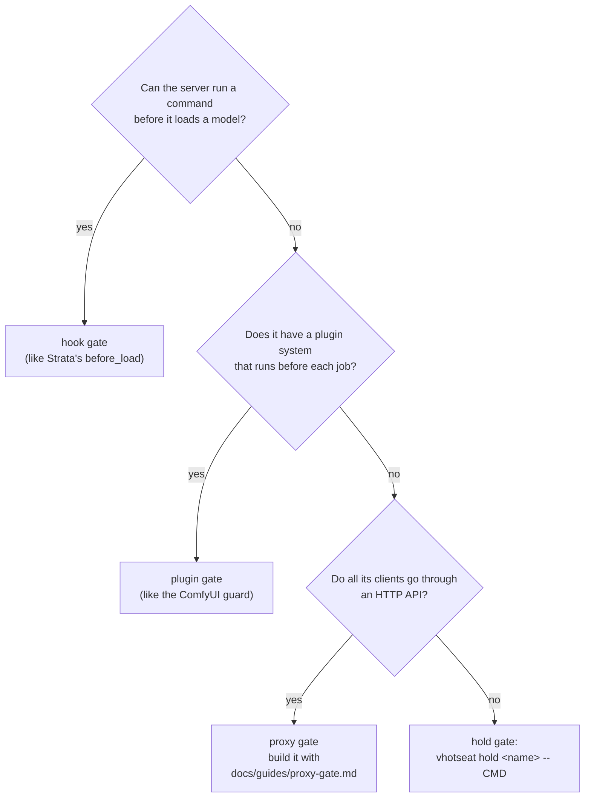

# Writing a driver

A **workload** is one server (or program) that uses the GPU. vhotseat needs two
things to manage one:

- a **driver**: how vhotseat asks it "are you loaded? are you busy?" and tells
  it "drop your VRAM, but don't interrupt anything";
- a **gate**: something that runs before it loads and asks vhotseat for the
  GPU, so it never loads on top of another workload.

Most servers need no code: the generic `http` driver describes one in YAML.
This guide covers the contract, the `http` driver's vocabulary, when a Python
driver is worth it, picking a gate, and testing. A coding agent can follow the
short version in
[kit/skills/vhotseat-add-workload](../../kit/skills/vhotseat-add-workload/SKILL.md).

## 1. What vhotseat asks of a workload

Everything vhotseat does is built from these questions and actions
(`vhotseat.drivers.base.Workload`):

| | Method | Meaning | Must be true of it |
| --- | --- | --- | --- |
| question | `probe(gpu)` | its part of `vhotseat status`: service up, API reachable, loaded or not | cheap; called on every status and gate |
| question | `active(st, gpu)` | does it hold the GPU, judged from `probe` and its VRAM | when the API is down, the VRAM decides |
| question | `busy()` | why it mustn't be released now, or `None` | **unknown counts as busy**: an API that doesn't answer returns a reason, not `None` |
| question | `model()` | which model it will load, for `admission.by_model` | optional |
| action | `release(wait, timeout)` | drop its models **without interrupting work**, waiting up to `wait` s for running work | raises `Busy` if work is still running, `ReleaseFailed` if a restart may help, `SwitchError` otherwise; returns once its VRAM is confirmed down |
| action | `load(wait)` | load ahead of its first request (`can_load()` says if it can) | optional; lazy servers load on their first request instead |
| action | `ready_to_restart()` | raise if restarting it now would lose something | e.g. ComfyUI waits until clients have read `/history` |

Shared by every driver (set from the config, not code):

| Field | Config key | Meaning |
| --- | --- | --- |
| `service` | `service: {systemd-user: UNIT}` or `{systemd: UNIT}` | started when stopped; restarted when `allow_restart` |
| `vram_selector` | `vram: {unit: X.service}` or `{process: SUBSTRING}` | how its processes are found on the GPU; defaults to the service's unit |
| `idle_vram_mib` | `idle_vram_mib` | VRAM it may keep and still count as released (CUDA context, caches) |
| `release_always` | `release.always` (http) | ask it to release even when it looks unloaded: a load may be under way before any VRAM shows |
| `allow_restart` | `allow_restart` | the arbiter may restart it, when idle, if releasing isn't enough |
| `admission` | `admission` | `min_available_ram_mib`, `min_free_vram_mib`, `by_model` |
| `gate` | `gate` | `kind` and its settings (§4) |

The one rule that matters: **release never interrupts running work.** If the
server can't tell you it's working, it can't be released safely while it is;
find out how it signals that (a queue, an in-flight count, a 409 on unload)
before writing anything else. If it has no signal at all, put a
[proxy](proxy-gate.md) in front of it: the proxy counts requests in flight.

## 2. The `http` driver

A workload whose answers are all one HTTP request each. Every request is
`{get: PATH}` or `{post: PATH}` (POST sends `{}`). A path starting with
`http://` goes to that address instead of the workload's `url` (a proxy in
front of it, say). Fields are read from the JSON answer by a dotted path:
`a.b.0.c` (a leading `$.` and `[0]` also work).

```yaml
workloads:
  myserver:
    driver: http
    label: My server                   # as shown to people
    url: http://127.0.0.1:9000
    service: {systemd-user: myserver}

    resident: {get: /health, path: loaded}      # required: loaded = this field is truthy
    busy:     {get: /status, path: in_flight}   # optional: truthy = working; else learned from release
    release:                                    # required
      pre: {post: "http://127.0.0.1:9001/_vhotseat/drain?wait={wait}"}   # optional, first
      post: /unload?wait={wait}                 # {wait}: seconds it may wait for running work
      timeout: 30                               # seconds the request may take on top of {wait}
      always: true                              # ask even when it looks unloaded
      busy_when: [{status: 409}, {path: status, in: [busy]}]   # → Busy
      ok_when:   [{status: 200}]                # default; anything else → SwitchError
    confirm: {vram_at_most: 0, timeout: 30}     # default: its VRAM ≤ idle_vram_mib, 30 s
    load: {post: /load, timeout: 300}           # optional: `switch myserver` loads it
    model: {get: /health, path: model}          # optional: for admission.by_model
```

**Rules** (`busy_when`, `ok_when`) match the release's answer:

| Rule | Matches when |
| --- | --- |
| `{status: 409}` | the HTTP status is 409 |
| `{path: x}` | field `x` is present and truthy |
| `{path: x, in: [a, b]}` | field `x` is one of the values |
| `{path: x, equals: v}` | field `x` equals `v` |
| `{status: 200, path: x, in: [...]}` | both |

A release is done when the request matched `ok_when` **and** its VRAM dropped to
`confirm.vram_at_most`. A server that answers "ok" before freeing memory is
fine; one whose VRAM never drops times out, which is a `ReleaseFailed` the
arbiter may fix with a restart if `allow_restart` is set.

**`release.always`.** A lazy server reports "not loaded" right up to the moment
its engine is up. Without `always`, vhotseat skips releasing a workload that
looks unloaded, and a load already under way would come up on top of the next
owner. Set it when the server can be mid-load without showing VRAM, which is
most LLM servers and every proxied workload.

**`busy:`** lets vhotseat wait for running work (`--wait`) instead of only
finding out from a refused release. Give it whenever the server can tell.

Validation names the key on every mistake (`workloads.myserver.release:
needs exactly one of get: or post:`), and a broken config makes every gate
refuse rather than let a load through unchecked.

## 3. When to write a Python driver

When the YAML can't express it: a release that's several requests, a request
body built from another answer (Ollama's unload needs the model name from
`/api/ps`), or state that isn't in one field. ComfyUI's driver
(`src/vhotseat/drivers/comfyui.py`) is the example: busy is read from `/queue`;
release is `/free`, then a VRAM wait; it raises `ReleaseFailed` when VRAM or RAM
stays high, so the arbiter restarts it, but only after `ready_to_restart()`
confirms the queue is still empty and the last result is old enough that
clients have read it.

A driver subclasses `Workload` (a dataclass) and implements `probe`, `active`,
`release`, and whichever of `busy`, `model`, `can_load`/`load` and
`ready_to_restart` apply. Use `vhotseat.util.http` for requests (it returns
`(status, parsed_body)`, with `status=None` when unreachable) and
`util.wait_until` for bounded waits.

**How drivers are registered: there's no plugin mechanism yet.** The driver
names are fixed in `vhotseat/config.py` (`DRIVER_KEYS`, and the `if` in
`workloads()` that builds each one). A new driver today means:

1. the class in `src/vhotseat/drivers/`;
2. its name and extra config keys in `DRIVER_KEYS`, validation in
   `validate()`, construction in `workloads()`;
3. tests against a fake server (see `tests/fakes.py`), and a pull request.

Before writing one, check whether a [proxy](proxy-gate.md) can do the extra
work instead: the proxy knows the server best, and its drain endpoint can
perform a multi-step unload, leaving the config to the `http` driver.

## 4. Pick the gate

The driver lets vhotseat release a workload. The gate makes the workload ask
before it loads. Take the first that applies:



| Gate | `gate.kind` | How it asks | What `doctor` checks |
| --- | --- | --- | --- |
| hook | `hook` | the server's pre-load command runs `vhotseat gate NAME`; exit 0 = load, 1 = refuse | `gate.config`: the server's config has the hook, strict, with a timeout ≥ `gate.timeout` |
| plugin | `plugin` | a plugin runs `vhotseat switch NAME --wait N` before each job and fails the job if that fails | `gate.custom_nodes`: the guard is installed |
| proxy | `proxy` | a proxy in front of the server calls `vhotseat.api` before forwarding | `gate.status`: the proxy answers `/_vhotseat/status` |
| hold | `hold` | the program is always run as `vhotseat hold NAME -- CMD` | nothing to check |

`vhotseat gate NAME` runs **inside** the server's own load, so it never waits on
the lock (a `switch NAME` holding it is waiting on this very load). It allows a
load that a `switch NAME` or `hold NAME` asked for, refuses while anything else
holds the lock, and otherwise releases the idle workloads itself, checks
admission, and allows. A busy workload means a refusal: the server should turn
that into a retryable error (Strata answers 503).

## 5. Admission

What must be available before it may load, checked after the others released:

```yaml
    admission:
      min_available_ram_mib: 46000   # MemAvailable, which counts reclaimable cache
      min_free_vram_mib: 14000       # catches VRAM vhotseat doesn't manage
      by_model:                      # needs `model:`; overrides the defaults per model
        big-model-q3:  {min_available_ram_mib: 46000}
        big-model-q2:  {min_available_ram_mib: 40000}
```

Measure it: from idle, note `MemAvailable` (`grep MemAvailable /proc/meminfo`),
load the model, note it again, and add ~1.5 GiB. When another workload still
holds too much RAM after releasing its models, vhotseat restarts it if it's idle
and `allow_restart` is set; if that isn't enough, the load is refused and the
event log says what was short.

## 6. Test it

1. `vhotseat doctor`: no FAIL. It checks the config, the GPU, each service and
   API, and each gate.
2. `vhotseat doctor --exercise NAME`: a real cycle on that one workload, timed:
   take the GPU (releasing the others), load it if it can be loaded ahead of a
   request, release it, confirm its VRAM came back. Run it with the GPU idle;
   it unloads things.
3. Take turns both ways: with another workload holding the GPU, use this one the
   way its clients do; the other is released first. Then the reverse.
4. **Never interrupt:** while this one is working (a long request, a running
   job), `vhotseat switch OTHER --wait 300` waits for the work to finish. While
   another is working, a load of this one waits or is refused, never lands on
   top.
5. `vhotseat doctor` again: no warning about VRAM held by processes no workload
   claims.

If you had to patch the server to make unloading work, record it under
`patches:` (see [config.example.yaml](../../config.example.yaml)) so `doctor`
notices when an update drops the patch.
